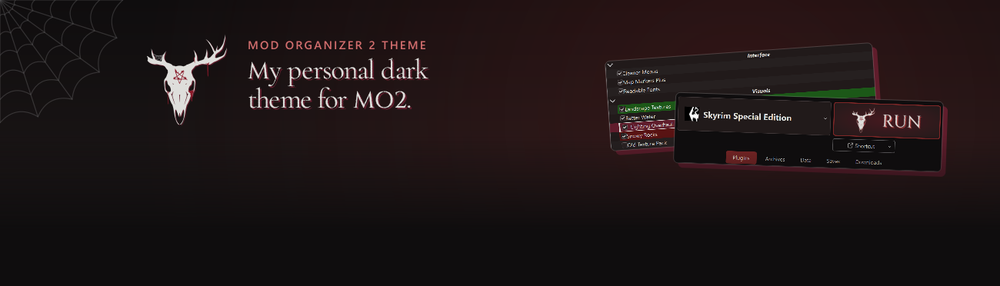
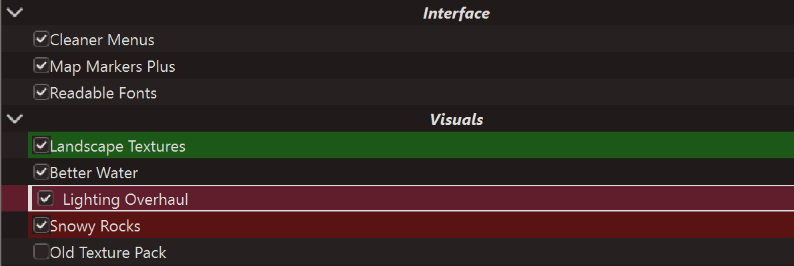
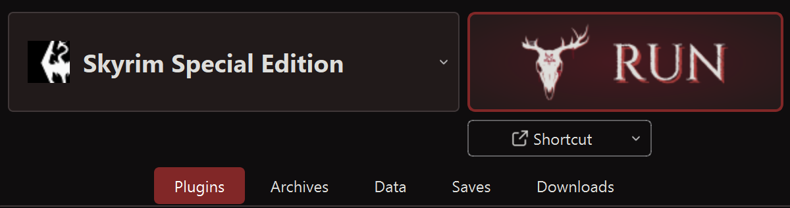

A dark theme for [Mod Organizer 2](https://github.com/ModOrganizer2/modorganizer) (MO2) in the colours of my
personal OC and upcoming VTuber model: near-black, bone-white and blood red, with red kept for what you've selected and
the button you press most. Written from scratch, with its own icons.

<picture>
  <source media="(prefers-color-scheme: dark)" srcset="docs/divider.png">
  
</picture>

## How it looks

- **Calm and dark.** Near-black backgrounds, bone-white text and silver-outlined buttons, so a long mod list stays easy to
  scan.
- **Red means something.** It marks only what you've selected and the Run button, nothing else.
- **Selections you can't lose.** The selected row gets a thin bone outline as well as its fill, so it stays clear next to
  MO2's own conflict highlights.
- **Easy to read.** Every text colour is checked to reach 4.5:1 contrast or better on every background it can sit on.

## What you get

- **A big, branded Run button.** Run and the program picker beside it are large and level, because you use them more than
  anything else. Run carries the sayngwyn deer skull and "RUN" on a dark red glow.
- **New icons throughout.** Simple line icons drawn for this theme: the toolbar, the buttons above the lists, check boxes,
  radio buttons and arrows. The problems icon is the only one in warning pink.
- **Quiet details.** Slim scrollbars, raised menus and tooltips, and tabs that turn red when selected.
- **MO2's own meanings left alone.** Conflict flags, plugin flags and the highlight colours you set in MO2 look exactly as
  MO2 draws them.

## Install

1. Close Mod Organizer 2.
2. From the download, copy the `stylesheets` folder into your MO2 folder (the one with `ModOrganizer.exe`). Say yes if
   Windows asks to merge it with the existing `stylesheets` folder.
3. Start MO2, open **Settings > Theme**, pick **sayngwyn** and press OK.
4. Restart MO2 once, so the toolbar picks up the new icons.

Don't install it as a mod from MO2's Downloads tab: themes go in MO2's own `stylesheets` folder. Made for Mod Organizer
2.5.2, tested with Skyrim Special Edition and Fallout 4.

## Good to know

- **Restart after picking it.** MO2 only loads toolbar icons when it starts, so the toolbar changes after a restart.
- **The title bar follows Windows.** If it stays white, set Windows to dark mode for apps: Settings > Personalization >
  Colors > "Choose your default app mode: Dark".
- **Links follow your Windows accent colour.** No MO2 theme can change link colours. With Windows' default blue they're a
  little dim on the dark background.
- **Conflict highlight colours are yours.** MO2 keeps them in Settings > Theme > Colors; the theme doesn't change them.
- **The Run button always says "RUN" in English,** because the word is part of its picture.
- **Programs pinned to the toolbar keep their own icons.** MO2 doesn't let themes replace them.

## More by sayngwyn

- **[Creations Browser](https://www.nexusmods.com/site/mods/2483)**: Browse Creations, download the free ones. ([source](https://github.com/sayngwyn/creations-browser))
- **[Hide Buttons](https://www.nexusmods.com/site/mods/1619)**: Hide the MO2 buttons you never use.
- **[Modlist Companion](https://www.nexusmods.com/skyrimspecialedition/mods/170511)**: Remembers every FOMOD choice you made in MO2.

Every sayngwyn mod and tool: [sayngwyn.com/projects](https://sayngwyn.com/projects) · [all of them on Nexus](https://www.nexusmods.com/profile/sayngwyn/mods)

Build it yourself

The theme is generated from `src/theme.qss`, one palette file (`scripts/palette.py`) and icons drawn in code
(`scripts/icons.py`):

    py -3.12 scripts/build.py

The result lands in `dist/sayngwyn/stylesheets`. Tests (contrast, icons, and that Qt accepts the stylesheet) run in a dev
environment:

    py -3.12 -m venv .venv
    .venv\Scripts\python.exe -m pip install -r requirements-dev.txt
    .venv\Scripts\python.exe -m pytest -q

The Run button's label (`src/marks/run-label.svg`) is drawn by `scripts/make_run_label.py`, which needs the dev
environment.

## Report a problem

Open an issue on [GitHub](https://github.com/sayngwyn/sayngwyn-theme/issues) or post in **Bugs** on the Nexus page, with a
screenshot and your MO2 version. You can also find me on [Discord](https://discord.gg/QZHymBYMxP).

---

Made with AI. Claude contributed heavily under my direction: I decided what it does and how it looks and checked it, and
the AI wrote most of the stylesheet, its icons, tests and these docs. It was checked live in a real Mod Organizer 2 with
Skyrim Special Edition and Fallout 4 before release.

## Licence

MIT. See `LICENSE`.

Two things in the theme are not under the MIT licence:
- **The sayngwyn deer skull mark** (`sayngwyn-skull.svg`, and `run-label.svg`, which contains it) is © sayngwyn, all
  rights reserved. It is not covered by this project's MIT licence and is included only for this theme's Run button. Forks
  must remove or replace it. See `src/marks/NOTICE.txt`.
- **Sayngwyn Serif** (`src/fonts/SayngwynSerif-Regular.ttf`, used to draw "RUN") is under the SIL Open Font License 1.1;
  see `src/fonts/OFL.txt`. The font file isn't part of the theme download.
